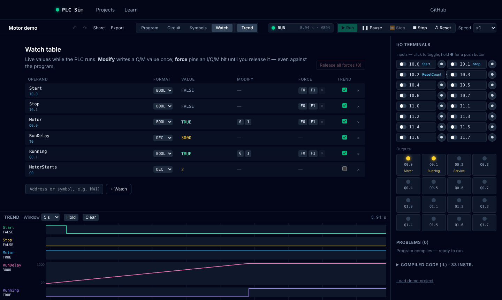

# PLC Sim

> Learn how a PLC thinks — one scan cycle at a time.

A browser-based PLC simulator for learning industrial automation. Wire push buttons, sensors, lamps
and motors to a virtual controller, program it in **Ladder**, **FBD**, **Structured Text** or **SFC**, then run
it and watch the controller execute your program scan by scan — or let it drive a simulated plant.


## Features

- **Realistic scan cycle** — process images, RUN / STOP / PAUSE / single STEP, adjustable speed
  (×0.1 – ×10). The cycle time follows the program (about 1 µs per instruction over a 10 ms
  minimum), a maximum cycle time of 150 ms calls OB80 or stops the CPU, programming errors (an array
  index out of range) call OB121 or stop it, OB100 runs at startup — and everything is written to a
  **diagnostic buffer**, like on an S7-1500.
- **Ladder editor** — contacts (NO, NC, P, N), coils (normal, negated, set, reset), timers,
  counters, compare, MOVE and MATH boxes, parallel branches, with **live power flow** while
  running. Copy / paste, insert before / after, change the element type in place.
- **Static analysis** — non-blocking warnings (double coils, a timer used twice, wired I/O the
  program ignores, markers read but never written) and a **cross-reference** list.
- **Structured Text** — hand-written lexer, recursive-descent parser and code generator:
  `IF / CASE / FOR / WHILE / REPEAT`, `TON / TOF / TP / CTU / CTD / R_TRIG / F_TRIG`, automatic
  `VAR` allocation, standard functions (`ABS`, `MIN`, `MAX`, `LIMIT`, `TRUNC`, `SHL`, `SHR`,
  `*_TO_*` conversions) and bitwise `AND / OR / XOR / NOT` on integers; CodeMirror editor with
  highlighting, completions and inline errors.
- **Circuit editor** — field devices wired to the PLC's terminals (Svelte Flow); devices are
  operated by hand while the program runs. Wired devices become symbols automatically. Includes
  an e-stop that latches, a HAND / 0 / AUTO selector and a contactor with a feedback contact
  (and an overload trip to simulate a fault).
- **Symbol table** — `Start` instead of `I0.0`, in both languages.
- **Online monitoring** — watch table with _modify_ and _force_, and a per-scan **timing diagram**.
- **Simulated plants** — traffic light, water tank with level sensors, sorting conveyor with a
  pusher, each with simple physics; connect one to any project.
- **28 auto-graded lessons** — build, find-the-bug and commissioning exercises, from a first rung
  to a crane with an encoder, a PID-tuned oven, a remote I/O station and two-hand control. Your
  program runs against test cases in a headless PLC (or through the wired circuit); every lesson
  ships a reference solution that the test suite proves passes, plus a live step-by-step guide.
- **Program organisation like in TIA Portal / CODESYS** — own `FUNCTION_BLOCK`s with
  multi-instances, `FUNCTION`s and `STRUCT` types in a project library (usable from every
  language, also as boxes in ladder), standard `SCALE` and `PID` blocks, one-dimensional `ARRAY`s
  (of numbers, structs or FB instances, with computed indexes), `VAR RETAIN` that survives Stop →
  Run, and a `CYCLIC_INTERRUPT` (like OB30) running at a fixed interval next to the main scan.
- **FBD** — function block diagram: AND / OR / XOR, comparators, arithmetic, MOVE, timers,
  counters, SR / RS, edges and every library block, negated inputs, `=` / `S` / `R` outputs and
  live signal flow. Translated to ST like SFC.
- **Export to real tools** — any project (ladder, FBD, SFC or ST) as a **TIA Portal SCL** external
  source with a tag table (CSV), as **PLCopen XML** for CODESYS, or as plain ST. A test translates
  every ladder lesson solution to ST and proves it still passes the lesson.
- **SFC / GRAFCET** — another language: steps with N / S / R actions, transitions with ST
  conditions (`Step.T`, `Step.X`), alternative and parallel branches. The chart is translated to
  ST and runs on the same compiler; active steps light up online.
- **On-call mode „Dyżur”** — a working machine breaks down at night (broken wire, stuck sensor,
  tripped overload, burnt auxiliary contact, inverter trips …). Find the failed component with the
  trend, watch table and I/O check; downtime and wrong repairs are scored. Every fault is proven by
  a test to cause a visible symptom.
- **More plants** — overhead crane (encoder, inertia, limit switches, hoist interlock), electric
  oven (first order + dead time, thermostat) and a remote I/O station on a fieldbus with a heartbeat.
- **Infrastructure track** — fieldbus and Modbus TCP frame builder, OT networking (subnet
  calculator and a „network doctor” game with seven real-world faults), SCADA / OPC UA / MQTT with a
  live topic broker, OT security zones with a firewall exercise, control cabinet (24 V supply
  sizing, voltage drop, wiring colours, designations) and machine safety (two-channel safety relay,
  ISO 13849-1 risk graph).
- **Drives in depth** — inside the inverter (interactive sine-triangle PWM, U/f), a PROFIdrive
  drive plant (STW1 / ZSW1, state machine 047E → 047F) and a drive lab where a flywheel braked too
  fast trips on DC overvoltage.
- **Control basics** — open vs closed loop, typical plants, a step-response lab: read K, T and the
  dead time off a curve, get SIMC PI settings and see the closed loop.
- **Story mode „Zgłoszenia”** — work orders from a shift foreman wrap the lessons into three weeks
  on a plant. Each ticket is graded with stars (attempts, hints), shows the downtime it cost and
  ends with a debrief; stars move you up from _Praktykant_ to _Starszy automatyk_.
- **Just-in-time tips and terms** — a short tip appears the first time you use a timer, wire a
  Stop button, add a drive, force a signal…, linking to the chapter that explains it. Abbreviations
  (TON, NC, RLO, HMI, VFD, PID…) explain themselves on hover or focus everywhere in the text.
- **Projects** — saved in the browser, undo / redo, export / import as JSON, and **share links**
  that carry the whole project in the URL fragment (nothing is uploaded).
- **Operator panel (HMI)** — drag-and-drop screen editor (buttons, switches, lamps, values,
  numeric inputs, bars, alarm list) bound to PLC tags, with alarm handling: come / go /
  acknowledge, history and an ACK bit for the program.
- **Frequency inverter** — a VFD device with RUN / REV / RESET, READY / FAULT / AT SPEED,
  analog speed setpoint and feedback words (0 … 27648), ramps and trips.
- **Commissioning exercises** — the program is right, the wiring is not: an I/O check sheet and
  tests that run the machine through the circuit, so they pass only once the wiring is fixed.
- **Reports** — a printable page (PDF via the browser) with the ladder diagram or ST code, symbol
  table and I/O list; each section also exports as PNG for lab reports.
- **Works offline** — installable PWA; a service worker caches the whole app after the first
  visit.

| Circuit                                                         | Watch table & trend                                                 |
| --------------------------------------------------------------- | ------------------------------------------------------------------- |
|                  |  |
| **Structured Text**                                             | **Lesson with a simulated plant**                                   |
|  |     |

## Architecture

```
 Ladder ─┐                                    ┌──────────── Web Worker ────────────┐
         ├─ compile ─▶ IR (instruction list) ─▶│ Plc.scan(10 ms) → plant model step │
 ST ─────┘                                    │ → trace sampling                    │
                                              └───────────────┬────────────────────┘
 UI (Svelte 5) ◀──────────── snapshots every frame ───────────┘
```

- **Engine** (`src/lib/engine`) — framework-free TypeScript: memory, IR, stack VM, IEC timers and
  counters, forcing. Time is passed in, so everything is deterministic. [More](src/lib/engine/README.md)
- **Compilers** — `src/lib/ladder/compiler.ts` and `src/lib/st/*`; both emit the same IR.
- **Runtime** — `RuntimeCore` (tested in Node) inside a Web Worker; the UI receives snapshots.
- **Plants & lessons** — `src/lib/processes`, `src/lib/lessons` (the runner reuses the engine).
- **POUs** — `src/lib/st/pou.ts` expands FBs, functions, structs and arrays into flat variables
  and inlined code before code generation (static memory, no recursion — as IEC 61131-3 allows).
- **FBD & export** — `src/lib/fbd` (diagram model, translation to ST, editor), `src/lib/export`
  (ladder → ST, SCL and PLCopen XML printers).
- **SFC & on-call** — `src/lib/sfc` (chart model, translation to ST, editor), `src/lib/oncall`
  (machines, incidents, scoring); faults are injected in `src/lib/circuit/model.ts`.
- **Story & tips** — `src/lib/story` (tickets, grading, career), `src/lib/tips` (triggers on the
  project state, glossary terms).

Design decisions are recorded as ADRs:

1. [One intermediate representation for every language](docs/adr/0001-shared-intermediate-representation.md)
2. [The PLC runs in a Web Worker, with simulated time](docs/adr/0002-runtime-in-a-web-worker.md)
3. [Ladder rungs are stored as a series–parallel tree](docs/adr/0003-ladder-as-a-tree.md)

## Quality

- ~570 unit tests (Vitest) for the engine, compilers, runtime, plants, lessons and persistence,
  with coverage thresholds enforced in CI (~97 % lines, ~90 % branches on the core).
- 44 end-to-end tests (Playwright) for the main flows: running the demo, forcing, ST errors,
  undo/redo, lessons, projects and share links.
- Strict TypeScript, ESLint and Prettier; GitHub Actions runs everything on every push.

## Tech stack

SvelteKit · Svelte 5 (runes) · TypeScript · Tailwind CSS · Svelte Flow · CodeMirror 6 ·
Vitest · Playwright · GitHub Actions · Cloudflare Workers

## Getting started

Requires Node 22 (see `.nvmrc`).

```sh
npm install
npm run dev            # dev server
npm test               # unit + component tests
npm run test:coverage  # core coverage report
npm run test:e2e       # Playwright end-to-end tests
npm run check          # type check
npm run lint           # prettier + eslint
npm run build          # production build
```

## Deployment

Built for **Cloudflare Workers** with `@sveltejs/adapter-cloudflare`: prerendered pages are served
as static assets, client-only routes (the editor) go through the worker. Configuration lives in
`wrangler.jsonc`.

```sh
npx wrangler login   # once
npm run preview      # build + run locally on the Workers runtime
npm run deploy       # build + deploy
```

See [PLAN.md](./PLAN.md) for the original plan and roadmap.
