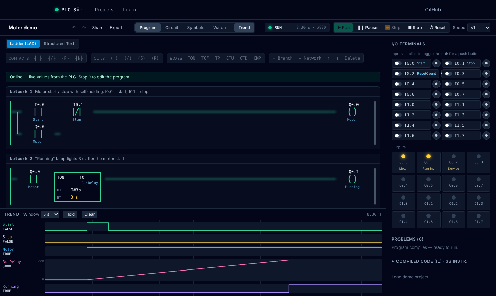
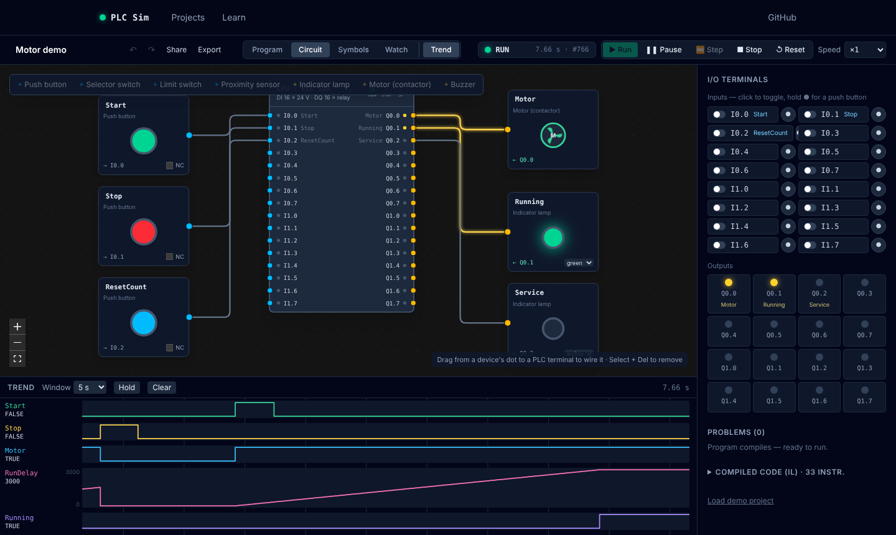
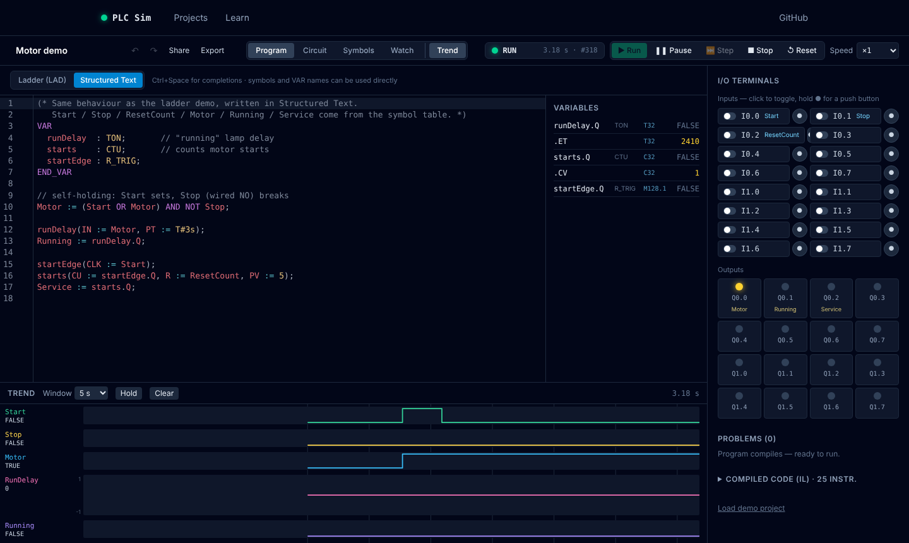
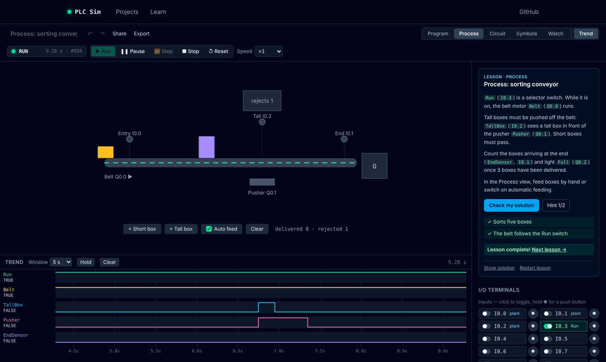

# PLC Sim

> Learn how a PLC thinks — one scan cycle at a time.

A browser-based PLC simulator for learning industrial automation. Wire push buttons, sensors, lamps
and motors to a virtual controller, program it in **Ladder Logic** or **Structured Text**, then run
it and watch the controller execute your program scan by scan — or let it drive a simulated plant.



## Features

- **Realistic scan cycle** — process images, RUN / STOP / PAUSE / single STEP, adjustable speed
  (×0.1 – ×10), faults and a watchdog.
- **Ladder editor** — contacts (NO, NC, P, N), coils (normal, negated, set, reset), timers,
  counters and compare boxes, parallel branches, with **live power flow** while running.
- **Structured Text** — hand-written lexer, recursive-descent parser and code generator:
  `IF / CASE / FOR / WHILE / REPEAT`, `TON / TOF / TP / CTU / CTD / R_TRIG / F_TRIG`, automatic
  `VAR` allocation; CodeMirror editor with highlighting, completions and inline errors.
- **Circuit editor** — field devices wired to the PLC's terminals (Svelte Flow); devices are
  operated by hand while the program runs. Wired devices become symbols automatically.
- **Symbol table** — `Start` instead of `I0.0`, in both languages.
- **Online monitoring** — watch table with _modify_ and _force_, and a per-scan **timing diagram**.
- **Simulated plants** — traffic light, water tank with level sensors, sorting conveyor with a
  pusher, each with simple physics.
- **7 auto-graded lessons** — from a first rung to process control. Your program runs against
  test cases in a headless PLC; every lesson ships a reference solution that the test suite
  proves passes (in LAD, and for several lessons also in ST).
- **Projects** — saved in the browser, undo / redo, export / import as JSON, and **share links**
  that carry the whole project in the URL fragment (nothing is uploaded).

| Circuit                                                         | Watch table & trend                                                 |
| --------------------------------------------------------------- | ------------------------------------------------------------------- |
|                  |  |
| **Structured Text**                                             | **Lesson with a simulated plant**                                   |
|  |     |

## Architecture

```
 Ladder ─┐                                    ┌──────────── Web Worker ────────────┐
         ├─ compile ─▶ IR (instruction list) ─▶│ Plc.scan(10 ms) → plant model step │
 ST ─────┘                                    │ → trace sampling                    │
                                              └───────────────┬────────────────────┘
 UI (Svelte 5) ◀──────────── snapshots every frame ───────────┘
```

- **Engine** (`src/lib/engine`) — framework-free TypeScript: memory, IR, stack VM, IEC timers and
  counters, forcing. Time is passed in, so everything is deterministic. [More](src/lib/engine/README.md)
- **Compilers** — `src/lib/ladder/compiler.ts` and `src/lib/st/*`; both emit the same IR.
- **Runtime** — `RuntimeCore` (tested in Node) inside a Web Worker; the UI receives snapshots.
- **Plants & lessons** — `src/lib/processes`, `src/lib/lessons` (the runner reuses the engine).

Design decisions are recorded as ADRs:

1. [One intermediate representation for every language](docs/adr/0001-shared-intermediate-representation.md)
2. [The PLC runs in a Web Worker, with simulated time](docs/adr/0002-runtime-in-a-web-worker.md)
3. [Ladder rungs are stored as a series–parallel tree](docs/adr/0003-ladder-as-a-tree.md)

## Quality

- ~260 unit tests (Vitest) for the engine, compilers, runtime, plants, lessons and persistence,
  with coverage thresholds enforced in CI (~97 % lines, ~90 % branches on the core).
- End-to-end tests (Playwright) for the main flows: running the demo, forcing, ST errors,
  undo/redo, lessons, projects and share links.
- Strict TypeScript, ESLint and Prettier; GitHub Actions runs everything on every push.

## Tech stack

SvelteKit · Svelte 5 (runes) · TypeScript · Tailwind CSS · Svelte Flow · CodeMirror 6 ·
Vitest · Playwright · GitHub Actions · Cloudflare Workers

## Getting started

Requires Node 22 (see `.nvmrc`).

```sh
npm install
npm run dev            # dev server
npm test               # unit + component tests
npm run test:coverage  # core coverage report
npm run test:e2e       # Playwright end-to-end tests
npm run check          # type check
npm run lint           # prettier + eslint
npm run build          # production build
```

## Deployment

Built for **Cloudflare Workers** with `@sveltejs/adapter-cloudflare`: prerendered pages are served
as static assets, client-only routes (the editor) go through the worker. Configuration lives in
`wrangler.jsonc`.

```sh
npx wrangler login   # once
npm run preview      # build + run locally on the Workers runtime
npm run deploy       # build + deploy
```

See [PLAN.md](./PLAN.md) for the original plan and roadmap.
